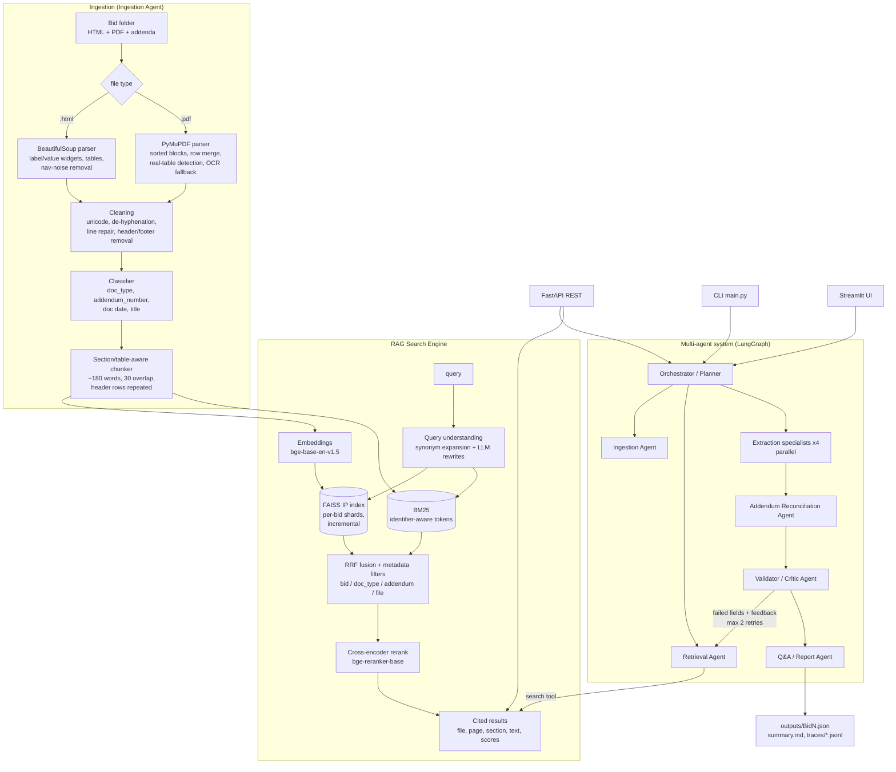
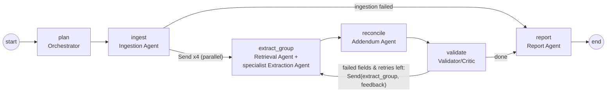
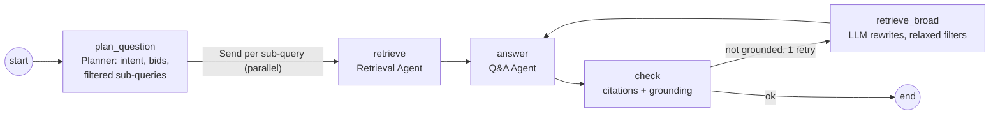

# Architecture

## System overview

## Extraction graph (LangGraph)

Shared state (`ExtractionState`): plan, ingestion report, `drafts` (field -> value/sources/confidence),
`evidence` (field -> passages), addendum change log, validation report, per-field validator feedback,
retry round, final record, errors. Parallel branches merge through dict reducers.

## QA graph (LangGraph)

## Agent responsibilities and messages

| Agent | Responsibility | Input message | Output message |
|---|---|---|---|
| Orchestrator / Planner | builds the execution plan, fans out work, decides retries and when the job is done | user goal | `ExecutionPlan` / `QAPlan` |
| Ingestion Agent | parse, clean, classify, chunk, index (incremental) | folder path | ingestion report (docs, chunks, warnings) |
| Retrieval Agent | query expansion/rewriting, filtered hybrid search + rerank | `FieldSpec` / `SubQuery` | `list[Evidence]` |
| Extraction specialists (identity, dates & logistics, commercial & legal, product & specs) | fill fields from evidence only | fields + evidence + validator feedback | `dict[field, FieldValue]` (`LLMExtractionResponse`) |
| Addendum Reconciliation Agent | change log per addendum, latest-wins application | drafts + addendum passages | `list[AddendumChange]` + updated drafts |
| Validator / Critic Agent | citation, grounding, format, LLM support check, confidence | drafts | `ValidationReport` |
| Q&A / Report Agent | cited answers; final JSON, Bid Summary, Markdown | evidence / validated fields | `QAAnswer` / `BidRecord` |

All messages are Pydantic models (`agents/schemas.py`); LLM outputs are validated against them with one
automatic repair round-trip on malformed JSON.
