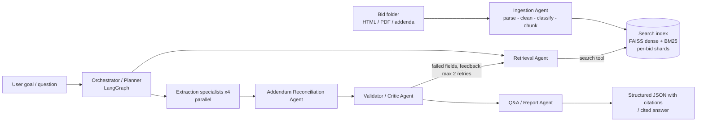

# RFP Intelligence Platform

Hybrid **RAG search engine** + **LangGraph multi-agent system** that makes bid / RFP folders (HTML portal
pages, RFP PDFs, addenda, specs, affidavits) searchable, answerable and extractable — every value backed by a
file + page citation, addendum changes applied, and "Not found in documents" instead of guesses.

- **Extraction mode** — `python main.py --bid ./data/Bid1` → `outputs/Bid1.json` (20 fields, value + sources +
  confidence + notes, addendum change log, validation counts) + `outputs/Bid1_summary.md`.
- **Question-answering mode** — `python main.py ask "What is the submission deadline for Bid1 after all addendums?"`
- **Search engine** standalone — CLI (`python main.py search ...`), REST API (`/index`, `/search`, `/ask`,
  `/extract`), Streamlit UI.

Nothing is hard-coded to the two sample bids: the bid id is the folder name, document types are inferred from
file names / first-page text with configurable rules, and field definitions live in `config/fields.yaml`.

---

> **Quick run guide (one page): [HOW_TO_RUN.md](HOW_TO_RUN.md). Demo script: [docs/demo_script.md](docs/demo_script.md).**
> Coding agents (Codex etc.): see [AGENTS.md](AGENTS.md). Scripts: `scripts\setup_windows.ps1`, `scripts\run_all.ps1`.

## 1. Quick start

```bash
# Python 3.10+ (tested on 3.12)
python -m venv .venv && .venv\Scripts\activate          # Linux/macOS: source .venv/bin/activate

# Install dependencies, then use scripts/enable_gpu.ps1 to install matching CUDA wheels on Windows.
pip install -r requirements.txt

copy .env.example .env      # then put your GROQ_API_KEY (or another OpenAI-compatible endpoint) in .env
# Windows + NVIDIA GPU (after stopping any running app):
powershell -NoProfile -ExecutionPolicy Bypass -File scripts\enable_gpu.ps1
```

One command — index (if needed) + multi-agent extraction for both sample bids:

```bash
python main.py --bid ./data/Bid1 --bid ./data/Bid2
```

Everything else:

```bash
python main.py index ./data/Bid1 ./data/Bid2            # incremental: unchanged bids are skipped
python main.py search "bid bond" --bid-id Bid1 --top-k 5
python main.py search "210-BLYZ"                        # exact part numbers work (BM25 leg)
python main.py search "new due date" --bid-id Bid1 --doc-type addendum --addendum 2
python main.py ask "Which affidavits are required for the Dell laptop bid?"
python main.py ask "Compare the warranty requirements of both bids."
python main.py qa-log                                   # 14 sample questions -> outputs/qa_log.md
python main.py eval                                     # retrieval evaluation -> eval/results.md
python main.py serve                                    # REST API on http://127.0.0.1:8000/docs
streamlit run ui/app.py                                 # web UI: search, chat, extraction
python main.py graph                                    # LangGraph diagrams (mermaid)
python main.py trace-report outputs/traces/<run>.jsonl  # readable agent trace
pytest                                                  # 52 unit tests (no network, no model download)
docker compose up                                       # API on :8000, UI on :8501
```

A new, unseen bid folder needs no code change: `python main.py --bid /path/to/Bid3`.

### Moving to a GPU machine (e.g. RTX 4050 laptop)

1. Copy the project folder (you can skip `index_store/`, `.cache/`, `logs/` — they are rebuilt).
2. Create the venv, install CUDA PyTorch first (command above), then `pip install -r requirements.txt`.
   Check: `python -c "import torch; print(torch.cuda.is_available())"` → `True`.
3. `.env` only needs your `GROQ_API_KEY`; the GPU defaults (`bge-base-en-v1.5`, `bge-reranker-base`) are used
   automatically (~1.5 GB download on first run).
4. `python main.py index ./data/Bid1 ./data/Bid2 --force` → `python main.py eval` →
   `python main.py --bid ./data/Bid1 --bid ./data/Bid2` → `python main.py qa-log`.
5. Optional, fully local LLM: install Ollama, `ollama pull qwen2.5:7b-instruct` (fits 6 GB VRAM) and use the
   Ollama block in `.env.example`.

### Hardware / model notes

| Setting | GPU default (`.env.example`) | Low-spec CPU fallback |
|---|---|---|
| `EMBEDDING_MODEL` | `BAAI/bge-base-en-v1.5` | `sentence-transformers/all-MiniLM-L6-v2` |
| `RERANKER_MODEL` | `BAAI/bge-reranker-base` | `cross-encoder/ms-marco-MiniLM-L-6-v2` |
| `DEVICE` | `auto` (CUDA when available) | `cpu` |

Changing the embedding model automatically triggers re-indexing (the model name is stored in each shard's
manifest). The LLM can be any OpenAI-compatible endpoint: Groq (default, `openai/gpt-oss-120b` with automatic
rotation to `gpt-oss-20b` / `qwen3.8-27b` on rate limits), OpenAI, or a local Ollama model on the GPU
(see `.env.example`). All keys and model names come from `.env` — no secrets in code.

---

## 2. Architecture



Detailed diagrams (component view, extraction graph, QA graph, agent message table): **[docs/architecture.md](docs/architecture.md)**.

```
ingestion/   pdf_parser.py, html_parser.py, cleaning.py, classify.py, chunking.py, pipeline.py
search/      embeddings.py, bm25.py, query.py, fusion.py, reranker.py, store.py, engine.py
agents/      orchestrator.py (LangGraph), retrieval_agent.py, ingestion_agent.py, extraction_agent.py,
             reconciliation_agent.py, validator_agent.py, grounding.py, qa_agent.py, report_agent.py,
             schemas.py (Pydantic messages), fields.py, services.py
core/        settings.py (env/.env), llm.py (OpenAI-compatible client), tracing.py, trace_report.py
api/         server.py (FastAPI)          ui/  app.py (Streamlit)
eval/        eval_set.json, run_eval.py, metrics.py, results.md
config/      fields.yaml, synonyms.yaml, doc_types.yaml
tests/       test_parsing.py, test_search.py, test_agents.py, test_api.py
outputs/     Bid1.json, Bid2.json, *_summary.md, qa_log.md, traces/
```

---

## 3. Part A — Ingestion & parsing

- **PDF (PyMuPDF)**: text blocks read in visual order; short blocks on the same visual row are merged into
  `a | b` lines so column layouts stay paired (e.g. *"Dell Latitude 5550 XCTO Base | 210-BLYZ"*). Headings
  are detected from font size, boldness, numbering and capitalisation.
- **Tables**: `page.find_tables()`; *layout-only* tables (one effective column — the Bid1 RFP template wraps
  whole pages in such tables) are discarded, real tables are compressed (empty cells/duplicate merged cells
  removed) and kept as table blocks; text inside them is not duplicated. Bid1's price schedule comes out as
  `16.01 Tier 3 Student Windows Laptop | 5,000 | Each`.
- **HTML (BeautifulSoup)**: removes nav/header/footer/cookie banners/hidden elements, converts label/value
  widgets (`*label*` + `*body/value*` siblings, `<dl>`, two-column tables) into `Label: Value` lines, keeps
  real tables and headings, drops repeated menu text.
- **Cleaning**: NFKC + typographic normalisation, de-hyphenation, line re-flow (keeps list items), dotted
  leader removal, e-mail repair for PDF-wrapped addresses, and running header/footer removal (lines in the
  top/bottom 8.5 % of the page that repeat on ≥ 50 % of pages, digits normalised so "Page 3 of 40" matches).
- **Metadata on every chunk**: `bid_id` (folder name), `file_name`, `doc_type`
  (`bid_page | rfp | addendum | specs | affidavit | form | other`), `addendum_number`, `page_number` /
  `page_end`, `doc_date` (only when labelled — e.g. "Issue Date"), `section` path, `chunk_type`.
  Classification rules are YAML (`config/doc_types.yaml`).
- **Failure handling**: unreadable/encrypted PDFs, parse errors and unsupported files are logged in the
  ingestion report and skipped; blank pages are recorded; pages with < 30 characters but with images or
  drawings are OCR'd (EasyOCR on GPU, or Tesseract) — `OCR_ENABLED`. (Bid1 pages 55–59 are blank and are
  reported as such.)

## 4. Part B — RAG search engine

### Chunking strategy (and why)

Section- and table-aware: chunks never cross a heading (RFP sections such as *Bonds*, *Submission*,
*Warranty* are self-contained topics), body text is packed to **~180 words (~250 tokens) with 30 words of
sentence-aligned overlap**, tiny sections are merged forward, tables are chunked as row groups with the header
row repeated, and oversized form cells are split like prose with their row label kept. Rationale: RFP facts are
short (a date, an amount, a form name) so small chunks keep precision high and avoid one chunk answering
many unrelated questions; 250 tokens plus a contextual header (`Document: <file> (addendum #2) | Section: …`)
stays well inside the 512-token window of BGE encoders and cross-encoders, and the header lets both BM25 and
the dense model match on document type / addendum number.

### Indexing

- Embeddings: `BAAI/bge-base-en-v1.5` (strong MTEB retrieval model, 768-d, fast on a laptop GPU; BGE query
  instruction applied to queries), configurable.
- Vector store: **FAISS** exact inner-product index over L2-normalised vectors + JSONL metadata.
- **Incremental indexing**: one shard per bid (`index_store/bids/<bid>/`) with file SHA-1s, embedding model and
  chunking version in a manifest. Re-indexing a bid only happens when its files, the model or the chunking
  logic change; other shards are never rewritten (unit-tested).

### Retrieval pipeline

1. **Query understanding** — config-driven procurement synonym expansion (`deadline` → *due date, closing date,
   submission deadline, …*) plus optional LLM query rewriting (used by the Retrieval Agent on retries).
   Multi-query: the original, rewrites and the expanded form each produce a dense ranking.
2. **Hybrid search** — dense (FAISS) + **BM25** with an identifier-preserving tokenizer (`ja-207652`,
   `210-blyz`, `wd22tb4`, `#e20p4600040` are kept whole *and* split into parts) fused with
   **Reciprocal Rank Fusion** (k = 60).
3. **Metadata filters** — `bid_id`, `doc_type`, `addendum_number`, `file_name` (single or lists) applied inside
   both retrievers (FAISS `IDSelectorBatch`, BM25 masking) — e.g. "only search Bid2 specs".
4. **Re-ranking** — top 30 fused candidates re-scored by a cross-encoder (`BAAI/bge-reranker-base`); agents can
   re-rank with a natural-language field description instead of the keyword query.
5. **Citations** — every result returns file, page range, section, chunk text and all intermediate scores.

### Search interfaces

- CLI: `python main.py search "<q>" --bid-id Bid2 --doc-type specs --top-k 5 --mode hybrid_rerank [--json]`
- REST (FastAPI, `python main.py serve`, docs at `/docs`): `POST /index`, `GET /search?q=&bid_id=&doc_type=&addendum_number=&top_k=&mode=`,
  `POST /ask`, `POST /extract`, `GET /bids`, `GET /records/{bid_id}`, `GET /health`.
- Web UI (bonus): `streamlit run ui/app.py` — search with filters, multi-agent chat with sources, extraction table.

### Retrieval evaluation

`eval/eval_set.json`: **29 question → expected source passage pairs** (15 Bid1, 14 Bid2) covering portal pages,
RFP body, price tables, addenda, specs and affidavits, including exact-identifier queries. A retrieved chunk is
relevant when it comes from the expected file and its page range overlaps an expected page. Run with
`python main.py eval`; full per-question table in [eval/results.md](eval/results.md).

Results (2026-11-09 CPU run with `BAAI/bge-base-en-v1.5` + `BAAI/bge-reranker-base`, 309 chunks, bid filter on):

| Configuration | Recall@1 | Recall@3 | Recall@5 | Recall@10 | MRR@10 | nDCG@10 | avg latency (CPU) |
|---|---|---|---|---|---|---|---|
| BM25 only | 0.828 | 0.966 | 1.000 | 1.000 | 0.899 | 0.877 | 0.7 ms |
| Dense only | 0.793 | 0.966 | 0.966 | 0.966 | 0.874 | 0.855 | 30.1 ms |
| Hybrid (RRF) | 0.793 | 0.966 | 1.000 | 1.000 | 0.882 | 0.870 | 26.7 ms |
| Hybrid + query expansion | 0.828 | 1.000 | 1.000 | 1.000 | 0.902 | 0.878 | 50.4 ms |
| Hybrid + cross-encoder rerank | **0.862** | 0.931 | 1.000 | 1.000 | **0.914** | 0.901 | 7576.1 ms |
| Hybrid + expansion + rerank (default) | **0.862** | 0.931 | 1.000 | 1.000 | **0.914** | **0.902** | 8183.4 ms |

The cross-encoder improves top-1 relevance and MRR, but does not improve every cutoff: hybrid with expansion
has higher Recall@3 in this run. All hybrid configurations reach Recall@5 of 1.0. Reranking 30 candidate
pairs per query dominates CPU latency; GPU latency has not yet been measured. These are local timings,
not controlled benchmarks. The 29-question evaluation checks passage retrieval, not LLM answer completeness;
summary evidence coverage and cache invalidation also have separate regression tests.

---

## 5. Part C — Multi-agent system

**Framework: LangGraph.** The task is a *stateful graph with fan-out, fan-in and a bounded feedback loop* —
exactly LangGraph's model (typed shared state with reducers, `Send` for dynamic parallel branches, conditional
edges for the retry loop, built-in recursion limits). It adds no hidden prompting (unlike CrewAI/AutoGen
role-play), so every LLM call and prompt is ours, testable with a fake LLM, and traceable.

| Agent | Single responsibility |
|---|---|
| **Orchestrator / Planner** (`orchestrator.py`, `qa_agent.plan`) | builds the execution plan, fans out field groups / sub-queries, routes failed fields back, decides when done |
| **Ingestion Agent** | detects file types, parses, cleans, classifies, chunks and (incrementally) indexes the folder — deterministic, no LLM |
| **Retrieval Agent** | expands / rewrites queries, applies metadata filters, calls the search tool (hybrid + rerank), returns `Evidence` with citations; broadens the search on retries |
| **Extraction Agents ×4** | specialists for *Identity & Contacts*, *Dates & Logistics*, *Commercial & Legal*, *Product & Specs*; run **in parallel**, see only retrieved evidence |
| **Addendum Reconciliation Agent** | per addendum, an LLM change log mapped to fields; changes applied deterministically, latest addendum wins (`replace` fields such as due date keep the original in `notes`; `append` fields such as required documents keep earlier info) |
| **Validator / Critic Agent** | citation guardrail, deterministic hallucination check (numbers, ids, emails, dates and times must appear in the cited evidence — dates compared by calendar day, times on a 24 h basis), format checks, batched LLM critic (yes/partial/no), confidence scoring |
| **Q&A / Report Agent** | cited answers (inline `[file, p.N]`), final JSON, generated Bid Summary, Markdown report |

**Orchestration requirements → implementation**

- *Shared state*: `ExtractionState` / `QAState` TypedDicts (plan, evidence, drafts, addendum changes, validation,
  feedback, retry round, final output, errors) with merge reducers for parallel branches.
- *Feedback loop*: failed fields (no citation, ungrounded tokens, unparseable date, critic "no") get the
  validator's issue text as feedback and are re-sent (`Send`) to their specialist with a broadened retrieval
  (LLM rewrites + feedback query + more candidates). `AGENT_MAX_RETRIES=2` bounds the loop; afterwards
  unverifiable values are nulled with the reason in `notes` (guardrail), format-only issues are kept and
  flagged.
- *Parallelism*: the four specialists (and QA sub-queries) run concurrently (`max_concurrency` configurable).
- *Structured outputs*: every agent-to-agent message and LLM response is a Pydantic model (`agents/schemas.py`);
  JSON mode + validation + one automatic repair round-trip.
- *Guardrails*: "Not found in documents" instead of guessing; every non-null value must cite ≥ 1 passage;
  uncited / ungrounded values are rejected.
- *Observability*: each agent step is a span (input, tool calls with args/results/latency, LLM model/tokens/
  latency/cache, output, error) streamed to `outputs/traces/<run>.jsonl`; run summary with tokens, estimated
  cost and wall time is embedded in every output JSON. Example: [docs/example_trace.md](docs/example_trace.md)
  (raw: `outputs/traces/example_trace_Bid1.jsonl`).
- *Error handling*: LLM timeouts / 5xx (exponential backoff), HTTP 429 (honours `retry-after`, rotates to fallback
  models, client-side tokens-per-minute budgeting), bad JSON (repair, then degrade), empty retrieval (field →
  not found), model-load races (locked lazy loading), per-node try/except so one failure never stops the graph
  (unit-tested with an always-failing LLM).

**Prompts** (all in code next to their agent): specialists get a role + focus, strict evidence-only rules,
addendum precedence, exact-copy rule for identifiers, per-field format hints, and validator feedback on retries.
The reconciler gets a field-mapping guide; the critic gets value + focused cited passages; the QA agent must cite
`[E#]` ids that are converted to `file, page` citations after validation. Each Q&A source also carries the
section heading, page range and the exact supporting sentence(s) of the cited passage (chosen by word overlap with
the claim it supports, verbatim so it can be found with Ctrl+F); the web UI shows citations as small numbered
superscripts with these quotes in a muted source list.

## 6. Part D — Structured extraction

Output per bid (`outputs/<bid>.json`):

```json
{
  "bid_id": "Bid1",
  "fields": {
    "Due Date": {"value": "2024-07-09 14:00 CST",
                 "sources": [{"file": "Addendum 2 RFP JA-207652 ....pdf", "page": 1}],
                 "confidence": 0.95, "notes": "... (original: 2024-06-27 14:00 CST)"},
    "Model_no": {"value": null, "sources": [], "confidence": 0.9, "notes": "Not found in documents. ..."}
  },
  "addendum_changes": [{"addendum_number": 2, "field": "Due Date", "change_type": "modification", "...": "..."}],
  "validation": {"passed": 16, "failed": 0, "not_found": 4},
  "documents": ["..."], "run": {"run_id": "...", "llm_calls": 13, "prompt_tokens": "...", "estimated_cost_usd": "..."}
}
```

Confidence = 0.45 × extractor self-confidence + 0.25 × best re-ranker score of the cited evidence + 0.30 ×
validation outcome (passed 1.0 / critic-partial 0.6 / failed 0.15). For "not found" fields confidence reflects
how sure we are the value is absent (high when even the best retrieved passage was weak).

### Results on the two sample bids

Validation: **Bid1 17 passed / 0 failed / 3 not found**, **Bid2 16 passed / 0 failed / 4 not found**
(2026-11-09 run: `openai/gpt-oss-120b` via Groq, retrieval with the CPU models `all-MiniLM-L6-v2` +
`ms-marco-MiniLM-L-6-v2`; Bid1 took 11 LLM calls, ~22k tokens, ~4 min, ~$0.005; full values in `outputs/`).

| Field | Bid1 (Dallas ISD) | Bid2 (Maryland STO) |
|---|---|---|
| Bid Number | JA-207652 | BPM044557; #E20P4600040 |
| Due Date | **2024-07-09 14:00 CST** — from Addendum 2 (original 27-JUN-2024 14:00) | 2024-06-10 14:00 EDT |
| Bid Submission Type | iSupplier portal or sealed hard copy; no fax/email | eMMA e-procurement only; no email/fax/mail/hand delivery |
| Term of Bid | 3 years + two 1-year extensions, max 5 years | not found |
| Pre Bid Meeting | 2024-06-10, Teams, encouraged / not mandatory | not found |
| Installation | imaging (Windows Autopilot, Chrome enrollment) + white-glove deployment (asset decal, reporting, etching — laptops only per Addendum 1) | not found |
| Delivery Date | not found (only "coordinate deliveries"; a guessed date `2024-09-01` was rejected by the validator twice) | within 45 days of award |
| Bid Bond | only "comply with any bond requirements noted elsewhere" — no amount stated | not found |
| Additional docs | certificate of insurance/bond, Form W-9, M/WBE letters of intent, factory-authorized repair certifications, Form 1295, M/WBE compliance forms | Proposal Affidavit, Mercury Affidavit, manufacturer Letter of Authorization, Contract Affidavit |
| MFG / Cooperative | manufacturer or authorized reseller / CTPA interlocal agreement (misses the EPCNT rider) | authorized Dell reseller / Desktop, Laptop and Tablet 2015 Master Contract 060B5400007 |
| Product | quantities per tier from the price schedule (e.g. 50,000 × Tier 1 Chromebook) | 30 × Dell Latitude 5550; 30 × Thunderbolt 4 Dock WD22TB4 |
| Model / Part no. | not found (spec-based RFP) | Dell Latitude 5550; WD22TB4 / SI# CC7802; WD22TB4 |

The addendum change log for Bid1 has 11 entries (etching only on laptops, Autopilot imaging, quantities spread
over the contract term, award timing, due-date extension by Addendum 2 …), each mapped to a field and cited.

Known extraction weaknesses in this run: the cooperative field lists CTPA but misses the EPCNT rider (found by
search/QA); Bid1 `Payment Terms` picks up the M/WBE prime-to-subcontractor payment clause (the RFP states no
buyer payment terms); Bid1 contact info lists the procurement desk and a buyer from the addendum but not every
named buyer; LLM output varies slightly between runs, so long list fields can differ run to run.

---

## 7. Deliverables

| Deliverable | Location |
|---|---|
| Source code (ingestion, search engine, agents, API/CLI, UI) | this repository |
| Architecture diagram | [docs/architecture.md](docs/architecture.md) (+ section 2) |
| JSON output per bid | [outputs/Bid1.json](outputs/Bid1.json), [outputs/Bid2.json](outputs/Bid2.json) (+ `_summary.md`) |
| Retrieval evaluation report | [eval/results.md](eval/results.md), question set [eval/eval_set.json](eval/eval_set.json) |
| Sample Q&A log (14 questions) | [outputs/qa_log.md](outputs/qa_log.md) |
| Agent trace of an extraction run | [docs/example_trace.md](docs/example_trace.md), `outputs/traces/example_trace_Bid1.jsonl` |
| Unseen-bid test (no code changes) | [examples/unseen_bid/](examples/unseen_bid/README.md): 20/20 fields correct, addendum updates applied |
| Tests | `tests/` (`pytest`) — parsing, search, agents (fake LLM), API |
| Docker + CI | `Dockerfile`, `docker-compose.yml`, `.github/workflows/ci.yml` (tests + retrieval eval) |
| Demo video (5–10 min) | recorded separately — script in [docs/demo_script.md](docs/demo_script.md) |

Broad Q&A requests such as "what do I need to do for this bid?" prompt the planner to retrieve status/deadline,
eligibility/submission, products/quantities, warranty, delivery/quote validity, and forms/invoicing evidence.
Summary context is selected across planned queries so general instructions cannot crowd out warranty or
quantity passages. Answers must preserve timing qualifiers and attribute portal status to the saved snapshot.
This improves coverage but still depends on the planner and answer model following their instructions;
it is not a deterministic completeness guarantee or a live portal check.

Bonus items implemented: web UI, OCR fallback, cross-bid comparison in QA, semantic cache of answered questions
(`.cache/qa_semantic_cache.jsonl`, keyed on index version + model + QA prompt fingerprint) and exact LLM response cache, cost/latency
tracking per run, Docker + CI.

## 8. Assumptions & known limitations

- Each sub-folder is one bid; the folder name is the bid id. Addendum numbers come from the file name or the
  first lines of the document; addenda without a number are treated as #1.
- The sample outputs in `outputs/` were produced on a CPU-only machine with the small fallback models
  (`all-MiniLM-L6-v2`, `ms-marco-MiniLM-L-6-v2`); the GPU defaults (`bge-base`, `bge-reranker-base`) are
  expected to retrieve better — re-run `python main.py eval` and the extraction after switching.
- Groq's free tier allows ~8k tokens/min per model; a full extraction is ~15–30k tokens, so the client budgets
  tokens and rotates models — runs take 1–3 minutes. A paid key or local Ollama removes the waits.
- Page numbers are physical PDF pages (the Bid1 RFP prints "Page X of 40" but has 62 physical pages).
- LLM extraction is not fully deterministic; temperature is 0 and responses are cached for reproducibility.
- Scanned documents depend on OCR quality; complex multi-column prose layouts may interleave columns.
- Fields that the documents genuinely do not contain (e.g. Bid1 model/part numbers, Bid2 term/pre-bid meeting)
  are reported as `null` with "Not found in documents" by design.
